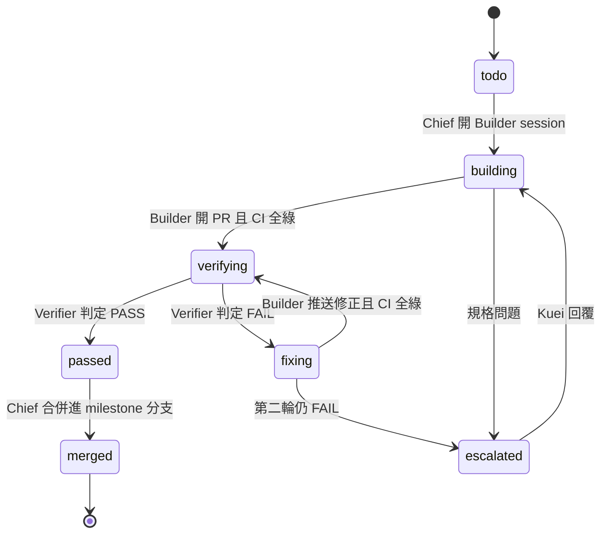

# 開發流程

`AGENTS.md` 是規則的摘要；這個檔案是完整說明。兩者不一致時以這個檔案為準，並在同一個 PR 修正 `AGENTS.md`。

## 1. 分支與合併

```
main                    只有 Kuei 合併
└─ milestone/M1         Chief 從 main 開出；ticket PR 的目標分支
   ├─ ticket/T-101      Builder 的分支，PR 目標是 milestone/M1
   └─ ticket/T-102
```

- 所有 GitHub 操作都以機器帳號 `bullet-bots` 進行；它只有寫入權限，規則集不允許它更新 `main`。
- Ticket PR 合併進 `milestone/Mx` 的條件全部由機器判定：CI 全綠、Verifier 的判定為 PASS、沒有動到範圍外的檔案、規格檔沒被修改。四項都成立時 Chief 合併，不需要 Kuei。
- Milestone 的所有 ticket 合併後，Chief 開 `milestone/Mx → main` 的 PR。Kuei 審查並合併。
- Kuei 合併後手動把該 milestone 的 migration 套用到共用資料庫。指令與檢查步驟在 milestone 報告裡。

## 2. 一個 milestone 的流程

1. Kuei 開一個 session，說明要開始哪個 milestone，並指定各角色的模型。這個 session 就是 Chief。
2. Chief 用 `plan-milestone`：讀 `docs/board.md` 與 `docs/milestones/README.md`，依 repo 現況確認或調整該 milestone 的 ticket，開一個標 `plan-approval` 的 issue。
3. **Kuei 回覆同意後才開工。**
4. Chief 開 `milestone/Mx` 分支，依依賴關係與平行規則開 Builder session。
5. Builder 用 `build-ticket`，完成後開 PR。
6. Chief 為每個 PR 開一個全新的 Verifier session。Verifier 用 `verify-ticket`，把判定寫成 PR 留言。
7. PASS：Chief 合併、更新看板。FAIL：進入修正輪（見第 4 節）。
8. 全部合併後，Chief 用 `milestone-report` 寫報告、開 milestone PR、關閉完成的子 session。

Chief 的 session 中斷時，Kuei 開一個新的 session 接手。新的 Chief 從 `docs/board.md` 與 GitHub 上的 PR 狀態重建進度，不需要舊的對話。

## 3. Ticket 的狀態



狀態只記在 `docs/board.md`。

## 4. 修正輪

- 第一輪：原本的 Builder session 依 Verifier 的報告修正。
- 第二輪：開一個新的 Builder session，改用較強的模型，從 Verifier 的兩份報告與目前的分支開始。
- 第二輪後仍 FAIL：停止，開 `needs-kuei` 的 issue，附上兩份 Verifier 報告與 Chief 對原因的判斷。

Verifier 每一輪都是全新的 session。

## 5. 找 Kuei 的方式

唯一的管道是 GitHub issue。Issue 由 `bullet-bots` 開立，所以 Kuei 會收到通知；Kuei 需要 watch 這個 repo。

| 標籤 | 用途 | 誰開 |
| --- | --- | --- |
| `plan-approval` | milestone 開始前的計畫核准 | Chief |
| `needs-kuei` | 規格問題、未授權的變更、修正兩輪失敗、未涵蓋的敏感程式 | 任何角色，經 Chief |

每個 issue 都要有選項與建議，格式見 `ask-spec-question`。等待期間，不依賴該 ticket 的其他 ticket 繼續進行；依賴它的標為 `blocked`。

Kuei 的回覆由 Chief 記進 `docs/decisions.md`；如果回覆改變了規格，Chief 在同一個 PR 修改 `spec/` 並更新受影響 ticket 的完成條件。

## 6. Context 與記憶

**短期記憶是 context window，用完即丟。**

- 一張 ticket 一個全新的 Builder session；一個 PR 一個全新的 Verifier session。
- 每個 session 只載入 ticket「要讀的檔案」列出的內容。整份規格超過三千行，全部載入會稀釋注意力。
- Chief 不把子 session 的完整輸出讀進自己的 context，只讀 PR 說明、Verifier 判定與 CI 結果。

**長期記憶是 repo。**

- 任何要留到下一個 session 的事實都寫進檔案；`AGENTS.md` 的「記憶」表規定每個檔案誰能寫。
- `docs/pitfalls.md` 只收「下一個 agent 不知道就會再犯」的事，由 Chief 在 milestone 結束時從各 PR 的提議中挑選。上限 30 條；超過時先刪掉已經被 CI 檢查或 skill 取代的條目。
- `docs/decisions.md` 只增不改。改變先前的決定時新增一列，並註明取代哪一列。

## 7. 驗證環境

- 每個 session 在自己的容器裡，有自己的 PostgreSQL。沒有共用的測試資料庫。
- 每個 scenario 從乾淨的資料庫開始，載入 `spec/background.md` 的固定資料。
- 時鐘由測試控制。
- CI 在每個 PR 上從乾淨的 checkout 執行全部檢查（`docs/ci-checks.md`）。
- Kuei 的獨立驗證：milestone 報告列出實際的操作流程與指令，Kuei 用自己選的模型與環境執行。

## 8. Milestone 報告與 PR

- 每個 milestone 一份 `docs/milestones/Mx.html`，樣板是 `docs/milestones/report-template.html`。內容：為何這樣設計、達成哪些 feature、Kuei 該如何審查與驗證。
- 每個 PR 的說明簡短寫出：完成了什麼、如何驗證、證據、milestone 報告的路徑。樣板是 `.github/PULL_REQUEST_TEMPLATE.md`。
- **證據。** 任何驗證都附證據：CLI 的指令與輸出直接貼上；有畫面的功能附截圖。GitHub 的 API 不能在留言中上傳圖片，所以截圖提交到 `docs/evidence/<ticket 編號>/`，再從 PR 連結。Milestone 報告引用同一批證據。
- **模型。** Builder 的交付留言與 Verifier 的判定留言寫明完成該工作的模型名稱與版本，從 session 的實際設定取得。Chief 在 `docs/board.md` 的備註欄記下每張 ticket 各輪使用的模型。

## 9. 這個流程在什麼情況下會失效

| 情況 | 後果 | 對策 |
| --- | --- | --- |
| 規格本身是錯的 | 全部通過但行為錯誤；自動驗證抓不到 | milestone 報告列出 agent 做過的每個判斷；Kuei 審查 milestone 時對照實際業務 |
| 測試被弱化 | 全綠但沒有驗證到規則 | 規格檔對 Builder 唯讀（CI 檢查）；Verifier 逐條比對 scenario 與步驟實作 |
| 步驟實作造假（步驟永遠通過） | 同上 | Verifier 抽查：故意改壞產品程式，確認對應的 scenario 會失敗 |
| 平行 ticket 互相衝突 | 合併卡住 | 路徑不重疊；migration 一次一張 |
| Chief 的 session 中斷 | 進度停住 | 狀態都在 repo；新的 session 可以接手 |
| 子 session 空轉 | 成本增加 | 修正輪上限兩輪；Chief 在 milestone 結束時關閉所有子 session |
