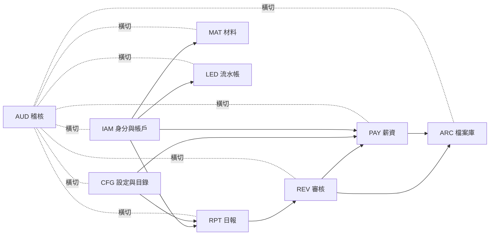

# 能力地圖

依「資料誰擁有、規則誰決定」切成 9 個能力域。箭頭表示「需要對方的資料才能運作」。

## Feature 索引

| 能力 | Feature | 規則數 | Scenario 數 | v2 行為 ID |
| --- | --- | --- | --- | --- |
| **IAM** 身分與帳戶 | [IAM-F01 登入](../spec/features/IAM-F01-sign-in.feature) | 3 | 4 | B-060 |
|  | [IAM-F02 登入鎖定與頻率限制](../spec/features/IAM-F02-sign-in-lockout-and-rate-limit.feature) | 4 | 7 | B-089, B-080 |
|  | [IAM-F03 Session 與登出](../spec/features/IAM-F03-session-and-sign-out.feature) | 3 | 8 | B-061, B-079 |
|  | [IAM-F04 帳戶生命週期與薪資設定](../spec/features/IAM-F04-account-lifecycle-and-pay-settings.feature) | 7 | 16 | B-007, B-010, B-012, B-013, B-015, B-017, B-074, B-095 |
|  | [IAM-F05 Owner 管理管理員](../spec/features/IAM-F05-owner-manages-administrators.feature) | 3 | 6 | B-096 |
|  | [IAM-F06 密碼變更與重設](../spec/features/IAM-F06-password-change-and-reset.feature) | 3 | 5 | B-008 |
|  | [IAM-F07 銀行帳號遮罩與顯示](../spec/features/IAM-F07-bank-number-masking-and-reveal.feature) | 4 | 7 | B-014, B-081, B-082, B-093 |
| **RPT** 日報 | [RPT-F01 送出日報](../spec/features/RPT-F01-submit-a-daily-report.feature) | 7 | 14 | B-062 |
|  | [RPT-F02 回報生命週期](../spec/features/RPT-F02-report-lifecycle.feature) | 4 | 7 | B-023, B-064 |
|  | [RPT-F03 歷史與匯出](../spec/features/RPT-F03-history-and-export.feature) | 4 | 8 | B-063 |
| **REV** 審核 | [REV-F01 確認或駁回回報](../spec/features/REV-F01-confirm-or-reject-reports.feature) | 3 | 5 | B-069, B-071 |
|  | [REV-F02 小組分配與份額保存](../spec/features/REV-F02-crew-split-and-stored-shares.feature) | 2 | 6 | B-044, B-091 |
|  | [REV-F03 自訂工項](../spec/features/REV-F03-custom-work-item.feature) | 5 | 7 | B-024 |
| **PAY** 薪資 | [PAY-F01 毛額、淨額與實發](../spec/features/PAY-F01-gross-net-and-final-pay.feature) | 6 | 12 | B-045, B-049, B-050, B-051 |
|  | [PAY-F02 保留金與年度上限](../spec/features/PAY-F02-retention-and-annual-cap.feature) | 5 | 12 | B-046, B-047, B-048, B-035 |
|  | [PAY-F03 封存帳戶的薪資](../spec/features/PAY-F03-archived-accounts-in-payroll.feature) | 3 | 7 | B-012, B-017 |
|  | [PAY-F04 年度結算](../spec/features/PAY-F04-year-end-settlement.feature) | 4 | 4 | B-090 |
|  | [PAY-F05 薪資批次、匯出與現金面額](../spec/features/PAY-F05-payroll-runs-exports-and-cash-breakdown.feature) | 6 | 13 | B-053, B-059, B-072 |
|  | [PAY-F06 個人統計與薪資試算](../spec/features/PAY-F06-personal-statistics-and-salary-trial.feature) | 4 | 7 | B-068 |
|  | [PAY-F07 跨帳戶統計總表](../spec/features/PAY-F07-cross-account-summary.feature) | 3 | 4 | B-073 |
| **MAT** 材料 | [MAT-F01 申請材料](../spec/features/MAT-F01-request-materials.feature) | 5 | 9 | B-028, B-057, B-065 |
|  | [MAT-F02 審核材料申請](../spec/features/MAT-F02-review-material-requests.feature) | 4 | 7 | B-056, B-070 |
|  | [MAT-F03 庫存匯入與暫存區](../spec/features/MAT-F03-inventory-import-and-quarantine.feature) | 2 | 4 | B-054, B-055 |
|  | [MAT-F04 庫存管理](../spec/features/MAT-F04-inventory-administration.feature) | 8 | 14 | B-026, B-027, B-029, B-036, B-066 |
| **LED** 流水帳 | [LED-F01 流水帳紀錄與餘額](../spec/features/LED-F01-ledger-entries-and-balances.feature) | 6 | 10 | B-030, B-031, B-076 |
|  | [LED-F02 證據檔與作廢](../spec/features/LED-F02-evidence-files-and-voiding.feature) | 4 | 8 | B-085, B-098 |
| **AUD** 稽核 | [AUD-F01 每個動作都重新檢查權限](../spec/features/AUD-F01-authorization-on-every-action.feature) | 3 | 3 | B-006, B-087 |
|  | [AUD-F02 稽核軌跡](../spec/features/AUD-F02-audit-trail.feature) | 5 | 9 | B-037, B-067, B-083, B-097 |
| **ARC** 檔案庫 | [ARC-F01 日月報檔案庫](../spec/features/ARC-F01-scheduled-and-manual-archives.feature) | 6 | 11 | B-077, B-078 |
| **CFG** 設定 | [CFG-F01 單價](../spec/features/CFG-F01-unit-prices.feature) | 4 | 5 | B-032, B-075, B-094 |
|  | [CFG-F02 費率](../spec/features/CFG-F02-rates.feature) | 4 | 6 | B-033, B-034, B-092 |
| | **合計** | **134** | **245** | |
